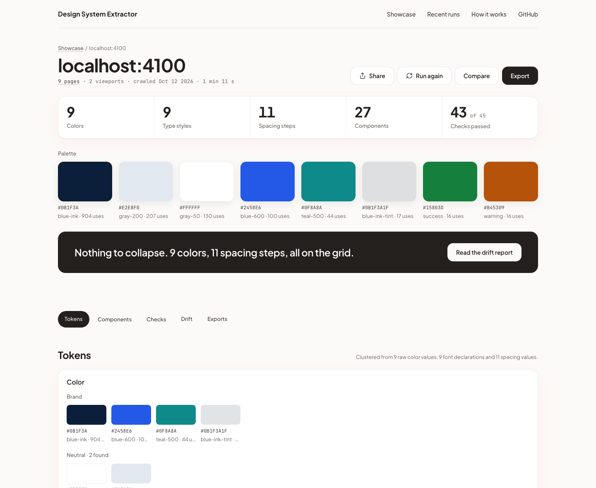

# Design System Extractor

Paste a URL. Get its design system back.

Tokens, components with every state, automated checks, and a drift report that shows where the system is leaking. Exports to CSS variables, JSON, Tailwind, W3C design tokens, a design-system.md, a prompt for any model, an MCP server and a CLI.



## How it works

1. A headless Chromium reads the site's sitemap and navigation, and a short model pass picks up to 12 pages that cover the most components.
2. Each page is captured at 1440 and 390 px: the DOM with computed styles, screenshots, and every control hovered, focused, tabbed and opened.
3. Raw values cluster into tokens; elements cluster into components with variants, states and the page they were first seen on.
4. Each component gets a sandboxed live preview when it renders faithfully, measured checks (contrast, focus, tap targets, names, reduced motion), and the drift report proposes a cleaner set that keeps every contrast ratio.
5. Everything exports as files, a prompt, an MCP server and a CLI. The details are on the How it works page and in `docs/specs/`.

## Local setup

Node 22, pnpm 9, Docker.

```
pnpm install
cp .env.example .env.local        # add ANTHROPIC_API_KEY and the two secrets it describes
docker compose up -d              # Postgres, Redis, MinIO
pnpm db:migrate
pnpm db:seed:fixtures             # six fixture runs, so the home page has a showcase
pnpm dev                          # the web app on http://localhost:3000 and the worker
```

`pnpm run doctor` checks every variable and service. `pnpm check` runs lint, types and unit tests; `pnpm verify:all` runs every gate (tests, end to end, evals, visual goldens, axe, Lighthouse, the copy rules, the audit).

## The CLI and the MCP server

```
npx @design-system-extractor/cli extract https://your-product.com --out ./dse-run
npx @design-system-extractor/cli export ./dse-run/run.json --format tokens.css
npx @design-system-extractor/cli serve ./dse-run          # then open it at /open
```

Every run page has the MCP install line for Claude Code:

```
claude mcp add design-system-extractor -- npx -y @design-system-extractor/mcp --run <run id>
```

## Eval results

Five fixture sites with planted components, states, check failures and drift, scored against their `expected.json` (`docs/evals.md`). The final live run:

| Fixture | Pages | Tokens P / R | Components P / R | States | Live previews | Planted checks | Drift |
| --- | --- | --- | --- | --- | --- | --- | --- |
| clean | 9, exact | 1.000 / 1.000 | 1.000 / 1.000 | 63 of 63 | 26 of 27 | 100% | none, contrast kept |
| messy | 12, exact | 1.000 / 1.000 | 1.000 / 1.000 | 73 of 73 | 29 of 31 | 100% | 16 of 16 found |
| tailwind | 9, exact | 1.000 / 1.000 | 0.964 / 1.000 | 63 of 63 | 27 of 28 | 100% | none, contrast kept |
| css-in-js | 9, exact | 1.000 / 1.000 | 0.964 / 1.000 | 63 of 63 | 27 of 28 | 100% | none, contrast kept |
| library | 7, exact | 1.000 / 1.000 | 1.000 / 1.000 | 54 of 54 | 22 of 22 | 100% | none, contrast kept |

The checks are measurements, not an audit: the measurable subset of WCAG 2.2, run on every component.

## Documents

`docs/` holds the spec this was built from, `docs/decisions.md` every ruling made along the way, `docs/traceability.md` where each section is implemented and tested, and `docs/deploy-runbook.md` how to put it online.

## License

MIT. Built by Brandon Church.
